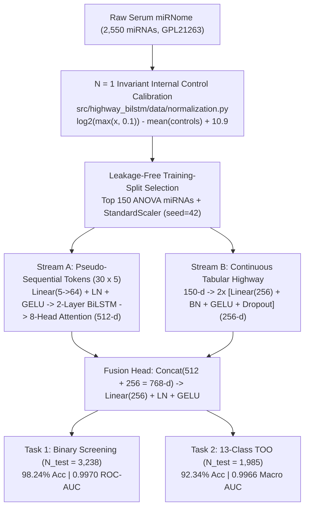

# Highway-BiLSTM for Multi-Cancer Early Detection and Tissue-of-Origin Classification

Official training, validation, hyperparameter optimization, and testing source code for:

> **Multi-Cancer Early Detection and Tissue-of-Origin Classification via Highway-BiLSTM Networks with Multi-Head Attention on Circulating Serum miRNomes**  
> Thanh-Hai Le, Quoc-Thinh Dinh, Cheng-Yang Liu, Quoc-Hung Phan, Chan-Khon Huynh, and Thi-Thu-Hien Pham

> **Repository Scope:** This repository contains **only** the reproducible source code, configurations, biomarker lists, and supplementary tables for data preparation, model training, validation, hyperparameter optimization, and testing. Scripts for generating manuscript documents and publication figures are intentionally excluded.

---

## Architecture Overview

The pipeline strictly separates **single-sample (`N = 1`) intra-sample calibration** (`src/highway_bilstm/data/normalization.py`) from the **dual-stream `HighwayBiLSTM` neural network** (`src/highway_bilstm/models/highway_bilstm.py`), eliminating cohort-level ComBat or pooled Z-score dependencies at inference time:



Complementarily, the scale-invariant **24-Rule BiLSTM** (`src/highway_bilstm/models/rule_bilstm.py`) encodes 24 pairwise expression inequalities (`configs/rule_24_pairs.csv`) for zero-shot external screening at a fixed prespecified threshold (`>= 9/24 = 0.3750`).

---

## Repository Structure

```text
highway-bilstm-mced/
├── configs/
│   ├── anova_top150_mirnas.csv          # Full list of 150 ANOVA-selected miRNAs & 30 tokens (Table S1)
│   ├── rule_24_pairs.csv                # Complete 24 pairwise miRNA diagnostic rules (Table S2)
│   ├── best_hyperparameters.json        # Optimal Optuna TPE configuration (Table 2)
│   ├── gpl21263_mimat_to_mirna.json     # GPL21263 MIMAT probe -> mature hsa-miR-* mapping (2,550 probes)
│   └── rules_24.json                    # Machine-readable rules & 3 invariant internal controls
├── src/highway_bilstm/
│   ├── constants.py                     # Seed (42), 13 cancer classes, rules, GEO cohort URLs
│   ├── data/
│   │   ├── normalization.py             # Single-sample (N = 1) Toray invariant internal control calibration
│   │   ├── preprocessing.py             # 24-rule sequence encoding, ANOVA F-test selection, 30x5 tokenization
│   │   ├── gse211692.py                 # GSE211692 GEO download, raw extraction, TNM clinical stage parser
│   │   ├── splits.py                    # Leakage-free 80/20 splits for Task 1 (12,952/3,238) & Task 2 (7,936/1,985)
│   │   └── external.py                  # 4 external GPL21263 GEO downloaders, parsers, healthy/benign subgroups
│   ├── models/
│   │   ├── highway_bilstm.py            # Dual-stream HighwayBiLSTM + Multi-Head / Additive Attention
│   │   ├── rule_bilstm.py               # 24-rule RuleChainingBiLSTM
│   │   └── baselines.py                 # 4-rule miRBiT & 24-rule prespecified score classifier (>= 9/24)
│   └── evaluation/
│       └── metrics.py                   # Binary, 13-class OvR Table 4, TNM stage, control-subgroup, PPV/NPV
├── scripts/
│   ├── prepare_data.py                  # Download all 5 GEO datasets & extract cached matrices/clinical stages
│   ├── train_task1_rule_bilstm.py       # Task 1: 24-rule BiLSTM + 4-rule miRBiT + naive TOO ablation
│   ├── train_task1_highway_bilstm.py    # Task 1: 150-feature dual-stream HighwayBiLSTM binary classifier
│   ├── train_task2_too_baseline.py      # Task 2: Baseline 13-class HighwayBiLSTM (reproduces Table 4)
│   ├── optimize_task2_optuna.py         # Task 2: 20-trial Optuna TPE search & weighted retraining
│   ├── evaluate_external_binary.py      # External zero-shot binary validation (reproduces Table 5)
│   └── evaluate_external_too.py         # External zero-shot 13-class TOO validation (N = 3,543 cancers)
├── supplementary/
│   └── Supplementary_Material.docx      # Tables S1 (150 miRNAs), S2 (24 rules), S3 (TNM stages & benign controls)
├── tests/                               # Pytest unit tests
├── requirements.txt
└── pyproject.toml
```

---

## Installation

Python `>= 3.10` and PyTorch `>= 2.1` (CUDA GPU recommended for training and Optuna search) are required.

```bash
git clone https://github.com/Thi-Thu-Hien-Pham/highway-bilstm-mced.git
cd highway-bilstm-mced
pip install -r requirements.txt
pip install -e .
```

*(If running without `pip install -e .`, prefix commands with `PYTHONPATH=src` on Linux/macOS or `$env:PYTHONPATH="src"` in PowerShell.)*

---

## Downloading the 5 NCBI GEO Cohorts (`GPL21263`) & Preparing Data

All five cohorts are publicly hosted on NCBI GEO under platform **GPL21263** (Toray 3D-Gene Human miRNA Oligo Chip):
1. `GSE211692` — Discovery cohort (`N = 16,190`: `9,921` across 13 solid cancers, `5,643` healthy volunteers, `626` benign controls)
2. `GSE106817` — External ovarian & multi-cancer cohort (`N = 4,046`)
3. `GSE112264` — External prostate & multi-cancer male cohort (`N = 1,591`)
4. `GSE113486` — External bladder & multi-cancer cohort (`N = 972`)
5. `GSE139031` — External glioma/CNS & benign control cohort (`N = 580`)

### Step 1: Download all 5 GEO datasets

```bash
# Downloads GSE211692_series_matrix.txt.gz, GSE211692_RAW.tar, and the 4 external series matrices
python scripts/prepare_data.py --download-all-geo --include-raw-tar --cache-dir data_cache
```

Extract `GSE211692_RAW.tar` into `data/GSE211692_RAW/`, place the cohort metadata files (`mapping_file.txt`, `meta_train_full.csv`, `metadata_full_benign_marked.csv`, and external `*_metadatah.csv`) under `data/`, and build the cached matrices:

### Step 2: Extract discovery matrices & TNM clinical stage metadata

```bash
python scripts/prepare_data.py \
  --raw-dir data/GSE211692_RAW \
  --mapping-file data/mapping_file.txt \
  --meta-train data/meta_train_full.csv \
  --meta-benign data/metadata_full_benign_marked.csv \
  --series-matrix data_cache/GSE211692_series_matrix.txt.gz \
  --cache-dir data_cache \
  --extract-full --extract-32 --parse-clinical
```

---

## Reproducing Manuscript Results (Tables 1–5)

Running `scripts/optimize_task2_optuna.py` also writes `outputs/task2_optuna/anova_tokenization_mapping.csv` from the Task 2 tuning split (`N = 6,745`, matching `configs/anova_top150_mirnas.csv`, Table 1, and Supplementary Table S1) along with `best_hyperparameters.json` (Table 2).

### Reproduce Table 3 — Comparative Benchmark (Task 1 & Task 2 on `GSE211692`)

```bash
# 1. Task 1 (24-Rule BiLSTM, 4-Rule miRBiT rerun, and Naive Rule-Chaining TOO Ablation; N_test = 3,238)
python scripts/train_task1_rule_bilstm.py \
  --parquet data_cache/mirna_32_dataset.parquet \
  --clinical-csv data_cache/GSE211692_clinical_metadata.csv \
  --output-dir outputs/task1_rule_bilstm

# 2. Task 1 (150-Feature Dual-Stream Highway-BiLSTM Binary Screening; N_test = 3,238)
python scripts/train_task1_highway_bilstm.py \
  --npz data_cache/full_mirnome_matrix.npz \
  --config configs/best_hyperparameters.json \
  --clinical-csv data_cache/GSE211692_clinical_metadata.csv \
  --output-dir outputs/task1_highway_bilstm

# 3. Task 2 (Baseline 13-Class Highway-BiLSTM; N_test = 1,985)
python scripts/train_task2_too_baseline.py \
  --npz data_cache/full_mirnome_matrix.npz \
  --clinical-csv data_cache/GSE211692_clinical_metadata.csv \
  --output-dir outputs/task2_too_baseline

# 4. Task 2 (Optuna TPE 20-Trial Optimization + Weighted Retraining; N_test = 1,985)
python scripts/optimize_task2_optuna.py \
  --npz data_cache/full_mirnome_matrix.npz \
  --clinical-csv data_cache/GSE211692_clinical_metadata.csv \
  --output-dir outputs/task2_optuna
# Or retrain directly from the optimal Table 2 hyperparameters:
python scripts/optimize_task2_optuna.py --skip-search --config configs/best_hyperparameters.json --npz data_cache/full_mirnome_matrix.npz --output-dir outputs/task2_optuna
```

### Reproduce Table 4 — Per-Class 13-Cancer TOO Performance (`N_test = 1,985`)

Running `scripts/train_task2_too_baseline.py` above writes the complete Table 4 per-class sensitivity, one-vs-rest specificity, precision, and F1-score table, confusion matrix, stage-stratified breakdown, and 150-feature ANOVA token mapping to:
- `outputs/task2_too_baseline/per_class_metrics.csv`
- `outputs/task2_too_baseline/confusion_matrix.csv`
- `outputs/task2_too_baseline/metrics.json`
- `outputs/task2_too_baseline/anova_tokenization_mapping.csv`

### Reproduce Table 5 — Zero-Shot External-Cohort Validation (`N = 7,189` across 4 GEO Cohorts)

```bash
# Binary screening at prespecified threshold >= 9/24 rules (0.3750) -> outputs/external_binary/external_binary_summary.csv
python scripts/evaluate_external_binary.py \
  --external-dir data_cache/external_cohorts \
  --meta-dir data/external_meta \
  --mimat-map configs/gpl21263_mimat_to_mirna.json \
  --output-dir outputs/external_binary

# Zero-shot 13-class TOO evaluation across 3,543 external cancer specimens -> outputs/external_too/external_cohorts_too_evaluation.csv
python scripts/evaluate_external_too.py \
  --checkpoint outputs/task2_optuna/best_optimized_model.pt \
  --config configs/best_hyperparameters.json \
  --discovery-npz data_cache/full_mirnome_matrix.npz \
  --external-dir data_cache/external_cohorts \
  --meta-dir data/external_meta \
  --mimat-map configs/gpl21263_mimat_to_mirna.json \
  --output-dir outputs/external_too
```

---

## Summary of Benchmark Results

| Model | Task / Cohort (`N_test`) | Accuracy | Sensitivity | Specificity (Healthy / Benign) | Weighted / Macro F1 | ROC-AUC |
| :--- | :--- | :---: | :---: | :---: | :---: | :---: |
| **150-Feature Highway-BiLSTM** | Task 1 (`3,238`) | **98.24%** | **99.75%** | **95.81%** (`99.65%` / `56.76%`) | — | **0.9970** |
| **24-Rule BiLSTM** | Task 1 (`3,238`) | 96.70% | 98.15% (`99.10%` Stage 0–II) | 94.35% (`99.65%` / `40.54%`) | 0.9734 | 0.9951 |
| **4-Rule miRBiT (Rerun)** | Task 1 (`3,238`) | 96.20% | 99.50% | 90.89% | — | — |
| **Naive Rule-Chaining BiLSTM** | Task 2 (`1,985`) | 45.65% | — | — | 0.4300 / 0.3910 | — |
| **Baseline Highway-BiLSTM** | Task 2 (`1,985`) | 92.29% | 92.90% (Stage 0–II Acc) | >98.1% OvR across 13 classes | 0.9224 / 0.9097 | 0.9858 |
| **Optuna Highway-BiLSTM** | Task 2 (`1,985`) | **92.34%** | **92.82%** (Stage 0–II Acc) | — | **0.9241** / **0.9119** | **0.9966** |

| External GEO Cohort (`GPL21263`) | Composition | `N` | ROC-AUC | Acc (`>=9/24`) | Sens | Combined Spec | Healthy Spec | Benign Spec |
| :--- | :--- | :---: | :---: | :---: | :---: | :---: | :---: | :---: |
| `GSE106817` | Ovarian & Multi-Cancer | 4,046 | 0.8868 | 80.5% | 87.8% | 77.5% | 84.8% | 16.4% |
| `GSE112264` | Prostate & Multi-Cancer Male | 1,591 | 0.7859 | 81.3% | 86.3% | 58.2% | 90.2% | 52.7% |
| `GSE113486` | Bladder & Multi-Cancer | 972 | 0.9173 | 85.3% | 85.0% | 88.0% | 88.0% | N/A |
| `GSE139031` | Glioma/CNS & Benign Controls | 580 | 0.5569 | 52.9% | 49.8% | 55.4% | 84.1% | 28.3% |

---

## Supplementary Material & Tests

- Complete supplementary tables (**Table S1**: 150 ANOVA miRNAs across 30 tokens; **Table S2**: 24 pairwise diagnostic rules; **Table S3**: TNM stage and benign-control stratification) are provided in [`supplementary/Supplementary_Material.docx`](supplementary/Supplementary_Material.docx), alongside machine-readable CSVs in [`configs/anova_top150_mirnas.csv`](configs/anova_top150_mirnas.csv) and [`configs/rule_24_pairs.csv`](configs/rule_24_pairs.csv).
- Run the unit test suite via:

```bash
pytest -v
```

---

## Citation

```bibtex
@article{le2026highwaybilstm,
  title={Multi-Cancer Early Detection and Tissue-of-Origin Classification via Highway-BiLSTM Networks with Multi-Head Attention on Circulating Serum miRNomes},
  author={Le, Thanh-Hai and Dinh, Quoc-Thinh and Liu, Cheng-Yang and Phan, Quoc-Hung and Huynh, Chan-Khon and Pham, Thi-Thu-Hien},
  year={2026}
}
```
